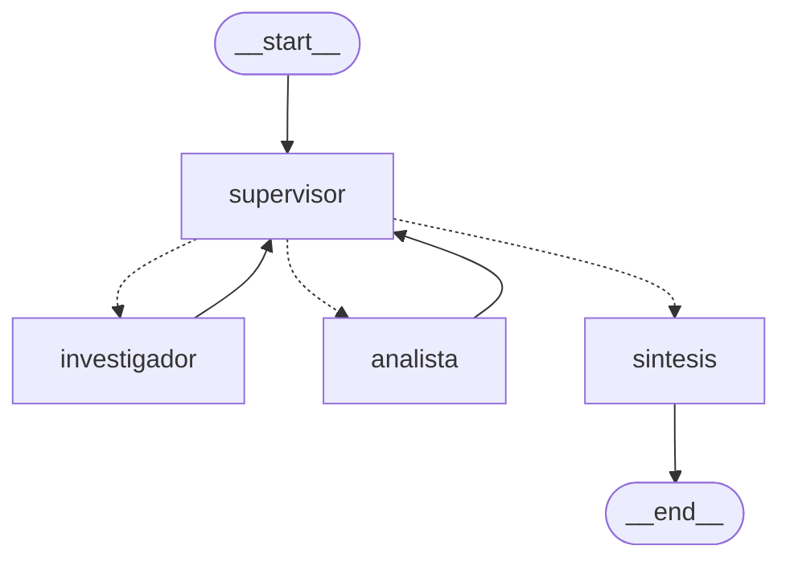

Pre-entrega 6: Orquestador multi-agente especializado

Prototipo de un orquestador jerárquico construido con LangGraph para una tienda de tecnología.
Un Supervisor recibe la consulta del cliente, delega en dos agentes especialistas (Investigador
y Analista), valida sus resultados con una rúbrica y cierra con una fase de síntesis.


Estructura

```
pre-entrega-6/
  config.py               configuración, modelos y utilidades
  datos.py                base de datos simulada (productos y reseñas)
  state.py                estado compartido (EstadoOrquestador)
  graph.py                construcción del grafo y diagrama
  main.py                 demo del flujo de delegación y traza
  agents/
    base.py               ejecución común de especialistas
    research_agent.py     agente Investigador y sus herramientas
    analyst_agent.py      agente Analista y sus herramientas
    supervisor.py         Supervisor (router + rúbrica) y nodo de síntesis
  grafo.png               diagrama del grafo
  traza_orquestador.json  traza de una ejecución real
  Pre_entrega_6.ipynb     notebook de Colab que demuestra el flujo paso a paso
```


Cómo ejecutarlo

```
python -m venv .venv
.venv\Scripts\activate        (Windows)
source .venv/bin/activate     (Linux / Mac)
pip install -r requirements.txt
```

Copiar .env.example como .env y completar GOOGLE_API_KEY (se obtiene gratis en aistudio.google.com).

```
python main.py                                   (consulta de demo)
python main.py "Compará el Basic 200 y el Pulse X1"
python graph.py                                  (genera grafo.png y muestra el Mermaid)
```


Diagrama del grafo




Las líneas punteadas son la arista condicional del supervisor (función enrutar, con retorno
Literal["investigador", "analista", "sintesis"]). Las líneas llenas son aristas fijas: cada
especialista siempre vuelve al supervisor.


Agentes

- Supervisor: decide quién interviene, redacta una instrucción específica para ese especialista
  y valida los resultados con una rúbrica antes de finalizar. Devuelve su decisión con salida
  estructurada (Pydantic), por lo que solo puede elegir nodos que existen.
- Investigador (create_react_agent): herramientas buscar_productos y obtener_resenas.
  No puede calcular.
- Analista (create_react_agent): herramientas calcular_estadisticas, analizar_sentimiento
  (por léxico) y calcular (calculadora segura con ast, sin eval). No puede buscar.
- Síntesis: redacta la respuesta final usando solo las contribuciones validadas.


Estado compartido

EstadoOrquestador hereda de MessagesState y agrega:
- siguiente e instruccion: la decisión del supervisor.
- contribuciones: lista que se acumula con operator.add. Cada contribución registra el paso,
  el agente, la instrucción recibida, las herramientas usadas y el resultado. Así se puede
  rastrear qué agente aportó qué información.
- pasos_supervisor, tarea_completa y respuesta_final.


Por qué una topología jerárquica

- La consulta tiene un orden natural (primero buscar, después analizar, después redactar) y un
  único responsable de decidir ese orden simplifica el control.
- Los especialistas no se comunican entre sí: todo pasa por el supervisor, que es el único que
  conoce el estado completo de la tarea.
- Agregar un especialista nuevo solo requiere sumar un nodo y describirlo en el prompt del
  supervisor.


Cómo se manejan los conflictos entre agentes

- Roles sin superposición: cada agente tiene solo sus herramientas (el investigador no calcula
  y el analista no busca), así no hay dos agentes produciendo el mismo dato.
- Autoridad única: si los resultados están incompletos o tienen errores, el supervisor no
  finaliza y reenvía la tarea con una instrucción de corrección (rúbrica de validación).
- Errores controlados: si un especialista falla, su contribución queda registrada como ERROR
  y el supervisor la ve en la siguiente decisión.
- Condición de parada: el supervisor tiene un máximo de 6 pasos; si se alcanza, se fuerza la
  síntesis. Además, el grafo tiene recursion_limit = 25 y cada especialista 8.
- Contexto acotado: cada especialista recibe solo su instrucción y los datos que necesita
  (el analista, solo lo que encontró el investigador), no todo el historial.


Sobre los modelos

La consigna no fija proveedor; se usó Gemini por su plan gratuito. Para repartir el cupo diario,
el supervisor y la síntesis usan un modelo y los especialistas otro. El supervisor tiene modelos
de respaldo (with_fallbacks): en la ejecución registrada el modelo principal estaba saturado
(error 503) y el sistema pasó automáticamente a gemini-3.5-flash-lite sin cortarse.


Resultado de la demo (ver traza_orquestador.json)

Consulta: "Compará los Pulse X1 y los Nova Pro: qué opinan los clientes, el puntaje promedio
de cada uno y cuál conviene más por relación precio/calidad."

```
FLUJO: supervisor -> investigador -> supervisor -> analista -> supervisor -> sintesis -> END

1. SUPERVISOR   -> investigador (todavía no hay datos)
2. INVESTIGADOR -> buscar_productos x2, obtener_resenas x2
3. SUPERVISOR   -> analista (ya hay precios y reseñas)
4. ANALISTA     -> calcular_estadisticas x2, analizar_sentimiento x2, calcular x4
5. SUPERVISOR   -> FINALIZAR (la rúbrica se cumple)
6. SINTESIS     -> respuesta final
```

Datos calculados por el Analista:

```
                    Pulse X1      Nova Pro
Precio              $45.000       $62.000
Puntaje promedio    4,2           3,8
Reseñas positivas   60%           60%
Reseñas negativas   0             1
Precio por punto    $10.714,29    $16.315,79
```

Recomendación final: Pulse X1, por mayor puntaje y menor precio por punto.


Limitación detectada

La síntesis escribió "ahorro directo del 37,78%". El analista había calculado que el Nova Pro es
37,78% más caro que el Pulse X1, que no es lo mismo: el ahorro real al elegir el Pulse X1 es del
27,4%. La rúbrica del supervisor valida a los especialistas, pero no a la síntesis. Una mejora
sería agregar un nodo de validación final que compare los números de la respuesta con los de
las contribuciones.