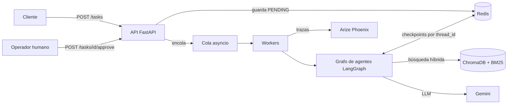
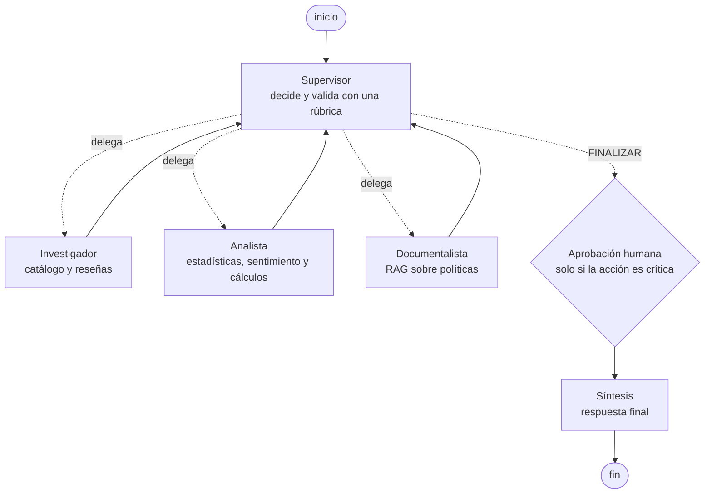

# Sistema Intelligence: asistente multi-agente con RAG

Asistente para una tienda de tecnología que responde consultas complejas combinando cuatro piezas:
conocimiento específico (RAG sobre las políticas de la tienda), razonamiento multi-paso (un Supervisor
que coordina a tres agentes especialistas), una API REST profesional y documentada (FastAPI con
validación Pydantic) y trazabilidad completa (Arize Phoenix).

Ejemplo de consulta que resuelve: "Compará los Pulse X1 y los Nova Pro, decime cuál conviene y cuánta
garantía tiene cada uno". Después, en la misma conversación: "¿Y si no me gustan, los puedo devolver?".


## Levantar el sistema (una sola instrucción)

Requisitos: Docker con Docker Compose.

```
bash run.sh
```

La primera vez crea el archivo .env a partir de .env.example: completar GOOGLE_API_KEY (gratis en
aistudio.google.com) y volver a ejecutar. El script levanta Redis, Phoenix y la API, y espera a que
estén listos.

- API y documentación interactiva (Swagger): http://localhost:8000/docs
- Phoenix (trazas): http://localhost:6006

Equivalente manual: docker compose up --build


## Arquitectura



1. POST /tasks valida la consulta con Pydantic, guarda el trabajo en Redis como PENDING, lo encola y
   responde enseguida (202) con un job_id y un thread_id. La API nunca espera al agente.
2. Un worker toma el trabajo y ejecuta el grafo. El checkpointer guarda el estado de la conversación
   en Redis en cada paso.
3. Si la consulta pide una acción crítica (reservar, apartar, pagar), el grafo se pausa con
   interrupt() y el trabajo queda en WAITING_APPROVAL hasta que un humano responde.
4. El trabajo termina en DONE con su resultado, o en FAILED con el error. El cliente consulta
   GET /tasks/{job_id}.


## Grafo de agentes



Diagrama generado por LangGraph: docs/grafo.png. Las líneas punteadas son la arista condicional del
supervisor (retorno Literal con el nombre del nodo); cada especialista vuelve siempre al supervisor.

| Agente | Herramientas | Límite de su rol |
| --- | --- | --- |
| Supervisor | Salida estructurada (DecisionSupervisor) | No busca ni calcula; solo delega y valida |
| Investigador | buscar_productos, obtener_resenas | No calcula ni consulta políticas |
| Analista | calcular_estadisticas, analizar_sentimiento, calcular | No busca información |
| Documentalista | buscar_conocimiento (RAG) | Solo responde con lo que está en los documentos |
| Síntesis | Ninguna | No agrega datos nuevos |


## Estructura del proyecto

```
app/
  main.py            API FastAPI (todos los endpoints con modelos Pydantic de entrada y salida)
  worker.py          cola de trabajos y estado en Redis
  graph.py           grafo de agentes + checkpointer
  hitl.py            aprobación humana con interrupt()
  observability.py   Arize Phoenix con OpenInference
  schemas.py         contratos Pydantic de la API y de las herramientas
  config.py          configuración desde variables de entorno, validada con Pydantic
  state.py           estado compartido del grafo
  datos.py           catálogo simulado
  agents/            supervisor, investigador, analista, documentalista
  rag/               ingesta (fragmentación por secciones) y recuperador híbrido
conocimiento/        políticas de la tienda en Markdown (base del RAG)
tests/               tests automáticos (pytest)
scripts/demo.py      las 5 pruebas del sistema contra la API
docs/grafo.png       diagrama del grafo
screenshots/         capturas de Phoenix
Pre_trabajo_final.ipynb  notebook de Colab donde se desarrolló y probó todo
```


## Endpoints

| Método y ruta | Qué hace |
| --- | --- |
| POST /tasks | Envía una consulta. Con thread_id continúa una conversación; sin él, crea una nueva |
| GET /tasks/{job_id} | Estado del trabajo y su resultado (respuesta, flujo de agentes, fuentes) |
| POST /tasks/{job_id}/approve | Aprueba o rechaza una acción crítica pausada |
| GET /conversations/{thread_id} | Historial de una conversación, leído del checkpointer |
| GET /reservas | Reservas registradas por la acción crítica |
| GET /health | Estado de la API, Redis y la base de conocimiento |


## Cómo cumple los requisitos

| Requisito | Implementación |
| --- | --- |
| Integración de los módulos 6 y 7 | Orquestador multi-agente (M6) dentro de la API con Redis y Phoenix (M7), en una sola estructura |
| Todo asíncrono | Endpoints async, Redis con redis.asyncio, grafo y LLM con ainvoke, Chroma con sus métodos async; lo pesado y sincrónico (cargar el modelo de embeddings) corre con asyncio.to_thread |
| Checkpointer | AsyncRedisSaver con thread_id por conversación: el historial sobrevive a un reinicio del servidor (prueba 3) |
| Validación con Pydantic | schemas.py: entradas y salidas de todos los endpoints (response_model), de todas las herramientas (args_schema y objetos de salida), la decisión del supervisor y la configuración |
| Observabilidad | Una traza por trabajo en Phoenix, con session.id = thread_id para agrupar conversaciones y status ERROR en las fallas |
| Sin hard-coding | Modelos, colección de Chroma, URLs y límites salen del .env |
| Despliegue local | bash run.sh o docker compose up |


## Pruebas

Tests automáticos (sin LLM): 16 tests de esquemas, herramientas y validaciones.

```
pytest
```

Pruebas del sistema (con trazas en Phoenix), repetibles con python scripts/demo.py:

| N° | Consulta | Flujo | Resultado |
| --- | --- | --- | --- |
| 1 | ¿Cuántos días tengo para devolver y quién paga el envío? | supervisor, documentalista, supervisor, síntesis | 10 días corridos; envío gratis por arrepentimiento (fuente: devoluciones.md) |
| 2 | Compará Pulse X1 y Nova Pro: puntaje, precio/calidad y garantía | supervisor, investigador, supervisor, analista, supervisor, síntesis | 4,2 contra 3,8; conviene el Pulse X1 ($10.714 contra $16.316 por punto); garantía 12 y 18 meses |
| 3 | (después de reiniciar la API) ¿Y si no me gustan, los puedo devolver aunque los haya abierto? | supervisor, documentalista, supervisor, síntesis | Recuperó el historial de Redis y entendió que "los" eran el Pulse X1 y el Nova Pro: sí, si están sin uso |
| 4 | Perfecto, reservame el que convenía más | WAITING_APPROVAL, aprobación, síntesis | Reserva N° 1 del Pulse X1, aprobada por un operador |
| 5 | ¿Hacen envíos a Uruguay? | supervisor, documentalista, supervisor, síntesis | "No se encuentra en las políticas de la tienda": no inventó la respuesta |
| Extra | Falla forzada | | Estado FAILED con el error, sin dejar al cliente esperando |


## Observabilidad (carpeta screenshots/)

- 01_trazas.png: una traza por trabajo.
- 02_traza_multiagente.png: árbol de la prueba 2, con el supervisor y los especialistas.
- 03_traza_rag.png: la búsqueda en la base de conocimiento y los fragmentos recuperados.
- 04_sesion.png: las 3 preguntas de la conversación demo-final agrupadas como sesión.
- 05_traza_hitl.png: ejecución pausada en el nodo aprobacion.
- 06_traza_fallida.png: el trabajo con falla forzada, marcado como error.


## Decisiones de diseño

- RAG con ChromaDB local (en lugar de Pinecone) para que el sistema se levante con un solo comando y sin
  cuentas externas. Fragmentación por secciones del Markdown, con metadatos de fuente, categoría,
  título y sección. Búsqueda híbrida BM25 + vectorial (pesos 0,5 / 0,5), top_k = 4.
- Contexto acotado: cada especialista recibe solo su instrucción (y el analista, los datos del
  investigador), no toda la conversación. El supervisor y la síntesis reciben el historial resumido
  (preguntas y respuestas finales).
- Condiciones de parada: máximo de pasos del supervisor, recursion_limit en el grafo y en cada
  especialista.
- Resiliencia: cada agente tiene una lista de modelos de Gemini; si uno falla o supera el tiempo
  máximo, se usa el siguiente.
- Gemini por su plan gratuito: tiene cupos bajos por día y por minuto, por eso hay pausas entre nodos
  y 2 workers.


## Limitaciones conocidas

- En la prueba 2, la síntesis escribió que el Pulse X1 es "un 37,78% más económico". El analista calculó
  bien que el Nova Pro es 37,78% más caro, pero el ahorro real del Pulse X1 es del 27,4%. La rúbrica del
  supervisor valida a los especialistas, no a la síntesis. Mejora propuesta: un nodo final que verifique
  los números de la respuesta contra las contribuciones.
- El detector de acciones críticas usa palabras clave; un clasificador con el LLM sería más flexible.
- La reserva registra la solicitud, no el producto: el producto elegido queda en la respuesta.
